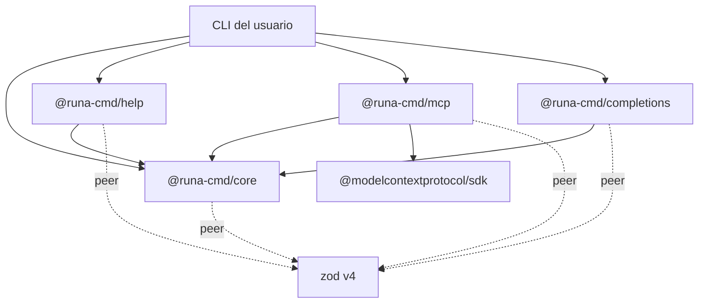
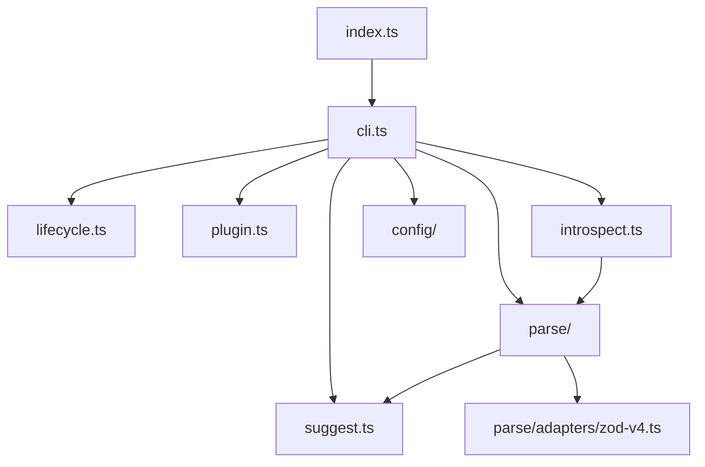

# Arquitectura

> **Fuente:** `packages/*/src` · **Verificado:** 2026-10-30

Runa es un framework de CLIs en TypeScript. El autor define un comando con schemas Zod, y de ese schema se derivan los tipos, la validación, la ayuda, las completions y las tools MCP.

## Paquetes

| Paquete | Responsabilidad | Dependencias de runtime | Doc |
|---|---|---|---|
| `@runa-cmd/core` | Comandos, parseo, resolución de valores, ciclo de vida, plugins, middleware, config, errores e introspección | Ninguna; Zod es peer | [core](./components/core.md) |
| `@runa-cmd/help` | Ayuda con temas y primitivas de layout | Ninguna; `core` y Zod son peers | [help](./components/help.md) |
| `@runa-cmd/mcp` | Servidor MCP desde los comandos | `@modelcontextprotocol/sdk` | [mcp](./components/mcp.md) |
| `@runa-cmd/completions` | Scripts para bash, zsh y fish | Ninguna; `core` y Zod son peers | [completions](./components/completions.md) |

`examples/demo` es una CLI de ejemplo que usa los cuatro paquetes.

## Reglas de dependencia

- **Los plugins dependen de `core`, nunca al revés.** `core` no conoce help, MCP ni completions.
- **`getSchema()` es la frontera de lectura.** Los plugins reciben datos de introspección (`CLISchema`), no internos.
- **`PluginAPI` es la frontera de escritura.** Agregar comandos, opciones globales o middleware exige declarar la capacidad.
- **`._zod` solo aparece en `packages/core/src/parse/adapters/zod-v4.ts`.** Lo verifica un test ([ADR-0010](./adr/0010-schema-adapter.md)).
- **`core` no tiene dependencias de runtime.** Solo `node:*` y el peer Zod.

## Estructura de `core`

`cli.ts` orquesta todo, y `runCLILifecycle` concentra casi toda la ejecución.

## Principios

Los principios y sus razones están en los ADRs. Los que más condicionan el diseño:

- [ADR-0020](./adr/0020-un-comando-para-personas-y-agentes.md): un comando, para personas y agentes.
- [ADR-0001](./adr/0001-zod-como-fuente-de-verdad.md): Zod como fuente de verdad.
- [ADR-0003](./adr/0003-parseargs-extrae-zod-valida.md): `parseArgs` extrae y Zod valida.
- [ADR-0004](./adr/0004-sistema-de-plugins.md): plugins con capacidades.
- [ADR-0006](./adr/0006-ciclo-de-vida-con-hooks.md): hooks, y cortes sin `process.exit`.

## Puntos débiles conocidos

- **El ruteo está en dos lugares.** `core` resuelve el comando con su árbol, y `findHelpTarget` lo busca en el schema. Hasta [T-205](./backlog.md#t-205-ruteo-único-para-la-ayuda), pueden diferir.
- **`defineCLI` todavía tiene un modo implícito de comando único.** Depende de que `commands` tenga una sola clave. `runCLI` ya usa un modo raíz explícito.
- **No existe "nombre de flag".** `--${name}` se arma por separado en `core`, help y completions.
- **`isCommand` está cuatro veces:** `cli.ts`, `plugin.ts`, `introspect.ts` y `mcp/src/schema.ts`.

Los tres primeros se resuelven con [ADR-0021](./adr/0021-help-y-version-en-core.md), [ADR-0023](./adr/0023-runcli-y-modo-raiz.md) y [ADR-0024](./adr/0024-kebab-case.md).
