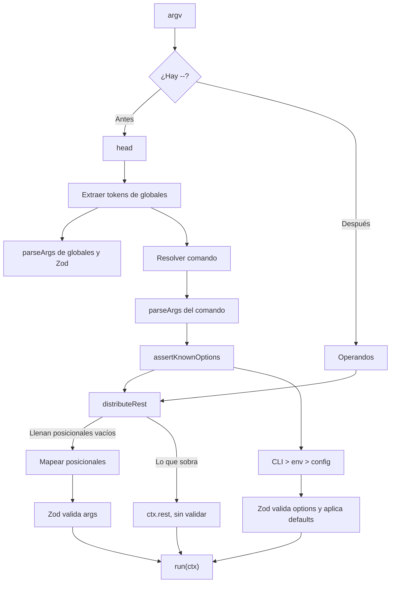

# Parseo y resolución de valores

> **Fuente:** `packages/core/src/cli.ts`, `packages/core/src/parse/` · **Verificado:** 2026-10-30

Describe cómo argv se convierte en `args` y `options` tipados.

## Etapas

1. **Separar `--`.** Solo el primero divide. Lo posterior no pasa por ningún parser: nunca se interpreta como flag. `distributeRest` lo usa para llenar los posicionales vacíos, donde un variádico cuenta como uno, y lo que sobra llega a `ctx.rest` ([ADR-0022](../adr/0022-separador-llena-posicionales.md)). Por eso `lint -- -a -b` llena `files`, y `lint a.ts -- --fix` deja `--fix` en `ctx.rest`.
2. **Extraer globales.** Un bucle propio saca los tokens que coinciden con opciones globales, con su valor si no son booleanas. El resto sigue al comando.
3. **Resolver el comando.** Ver [ciclo de vida](./cli-lifecycle.md).
4. **Configurar `parseArgs`.** `buildParseArgsConfig` declara booleanos como `boolean` y todo lo demás como `string`, con `strict: false` y `allowNegative: true`.
5. **Rechazar desconocidas.** `assertKnownOptions` compara las claves producidas con las registradas, salvo que `strictOptions` sea `false`.
6. **Detectar valores faltantes.** `assertOptionValues` revisa los tokens de `parseArgs`. Una opción sin valor, o seguida de una flag registrada, es un error de uso. `--tag=--force` y `--tag -texto` son valores válidos.
7. **Cargar config**, si `config` está definido.
8. **Resolver y validar.** `resolveValues` mapea, mezcla y llama a Zod.
9. **Avisar deprecaciones.** `deprecationWarnings` escribe en stderr por cada opción deprecada que se haya usado, desde cualquier fuente.

## Prioridad de valores

Si no hay valor, la clave se omite para que Zod aplique `.default()` o reporte que falta. Por eso los defaults nunca se pasan a `parseArgs`: lo que devuelve cuenta como argumento de CLI y le ganaría a env y config.

## Coerción

| Tipo | Regla |
|---|---|
| Número | `coerceNumberValue` convierte strings, salvo vacíos o de espacios |
| Booleano | `coerceBooleanValue` acepta `true`, `1`, `false` y `0`, sin distinguir mayúsculas; el resto lo rechaza Zod ([ADR-0028](../adr/0028-coercion-booleana.md)) |
| Enum y string | Sin coerción |

## Posicionales

- Se asignan por orden de claves.
- El último `z.array()` recibe el resto.
- Si sobran y no hay variádico, es un error de uso.
- Si faltan, se omiten y Zod decide.
- Un comando sin `args` también pasa por este mapeo: cualquier posicional es un error de uso.

## Mensajes de error

`humanizeArgIssues` y `humanizeOptionIssues` reescriben los issues de Zod. Algunos ejemplos:

| Caso | Mensaje |
|---|---|
| Falta un argumento | `Missing required argument: <name>` |
| Falta una opción | `Missing required option: --name` |
| Enum inválido | `Invalid value for --name. Expected one of: a, b` |
| Tipo inválido | `Invalid value for --name: expected number` |
| Flag desconocida | `Unknown option: --name. Did you mean '--other'?` |
| Falta el valor | `Option -n, --name requires a value` |
| Posicional de más | `Unexpected positional argument: 'x'` |

`ValidationError` antepone la ruta del issue, salvo que el mensaje ya la nombre como `<name>` o `--name`. Las sugerencias toleran una distancia de la mitad del largo del texto, hasta 3.

Si la CLI tiene una opción global `help`, los errores de uso terminan con `Run '<cli> --help' for usage.`.
