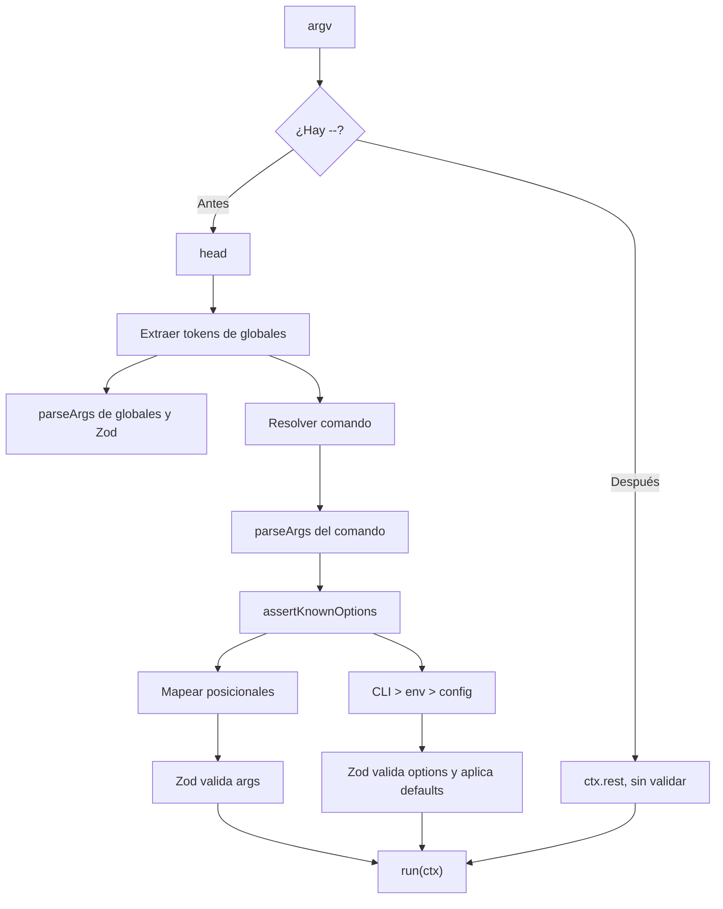
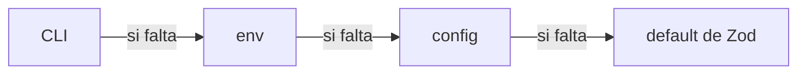

# Parseo y resolución de valores

> **Fuente:** `packages/core/src/cli.ts`, `packages/core/src/parse/` · **Verificado:** 2026-10-30

Describe cómo argv se convierte en `args` y `options` tipados.

## Etapas

1. **Separar `--`.** Solo el primero divide. Lo posterior no pasa por ningún parser.
2. **Extraer globales.** Un bucle propio saca los tokens que coinciden con opciones globales, con su valor si no son booleanas. El resto sigue al comando.
3. **Resolver el comando.** Ver [ciclo de vida](./cli-lifecycle.md).
4. **Configurar `parseArgs`.** `buildParseArgsConfig` declara booleanos como `boolean` y todo lo demás como `string`, con `strict: false` y `allowNegative: true`.
5. **Rechazar desconocidas.** `assertKnownOptions` compara las claves producidas con las registradas, salvo que `strictOptions` sea `false`.
6. **Cargar config**, si `config` está definido.
7. **Resolver y validar.** `resolveValues` mapea, mezcla y llama a Zod.

## Prioridad de valores

Si no hay valor, la clave se omite para que Zod aplique `.default()` o reporte que falta.

Una excepción involuntaria: los booleanos con default reciben ese valor desde `parseArgs`, que cuenta como CLI (KI-002 en [known issues](../known-issues.md)).

## Coerción

| Tipo | Regla |
|---|---|
| Número | `coerceNumberValue` convierte strings, salvo vacíos o de espacios |
| Booleano | Sin coerción desde env o config (KI-018) |
| Enum y string | Sin coerción |

## Posicionales

- Se asignan por orden de claves.
- El último `z.array()` recibe el resto.
- Si sobran y no hay variádico, es un error de uso.
- Si faltan, se omiten y Zod decide.
- Sin `args` declarados, `allowPositionals` queda en `false` y `parseArgs` lanza su propio error (KI-024).

## Mensajes de error

`humanizeArgIssues` y `humanizeOptionIssues` reescriben los issues de Zod. Algunos ejemplos:

| Caso | Mensaje |
|---|---|
| Falta un argumento | `Missing required argument: <name>` |
| Falta una opción | `Missing required option: --name` |
| Enum inválido | `Invalid value for --name. Expected one of: a, b` |
| Tipo inválido | `Invalid value for --name: expected number` |
| Flag desconocida | `Unknown option: --name. Did you mean '--other'?` |

`ValidationError` antepone la ruta del issue, por ejemplo `content: Missing…` (KI-027).
