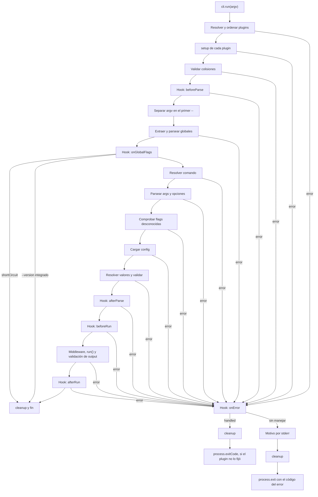
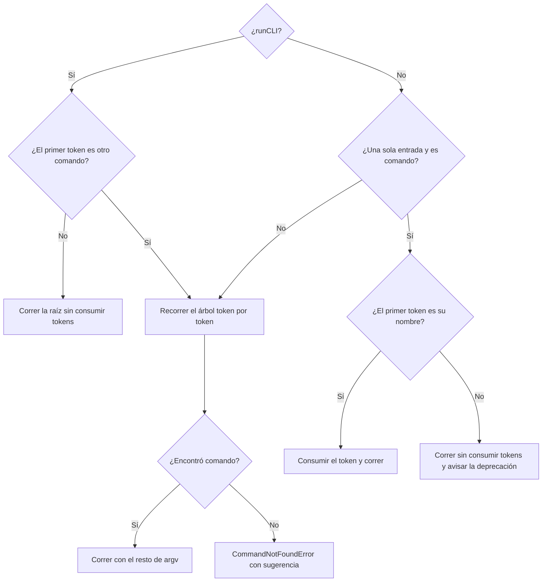
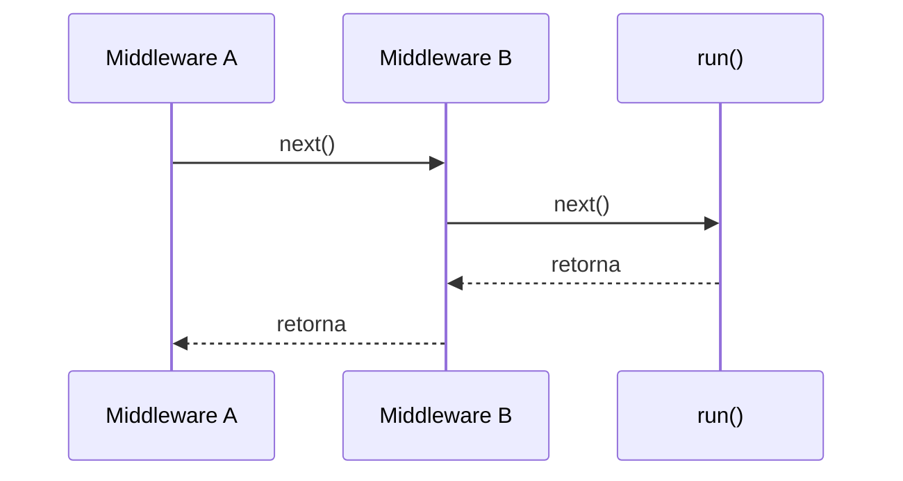

# Ciclo de vida de una ejecución

> **Fuente:** `packages/core/src/cli.ts` (`runCLILifecycle`) · **Verificado:** 2026-10-30

Describe qué pasa desde `cli.run()` hasta que el proceso termina.

Solo una parte depende de cómo se invocó: elegir el comando y sus valores. `selectFromArgv` lo hace desde argv, y `selectFromInput` desde un objeto, sin parsear tokens. De ahí en adelante, el recorrido es uno solo. `ctx.invocation` indica el origen: `{ surface: 'cli' }` o `{ surface: 'tool', tool }`.

El motivo se imprime antes de `cleanup`, para que siga visible aunque `cleanup` se cuelgue. Los mensajes están en [core](../components/core.md#cómo-termina-una-ejecución-fallida).

## Hooks

| Hook | Cuándo | Contexto disponible | Uso típico |
|---|---|---|---|
| `beforeParse` | Antes de parsear | `cli`, `rawArgs` | Modificar argv |
| `onGlobalFlags` | Con globales ya parseadas, antes de resolver el comando | `globalOptions`, `shortCircuit()` | `--help`, `--mcp` |
| `afterParse` | Con todo parseado | `command`, `args`, `options` | Validaciones cruzadas |
| `beforeRun` | Antes del middleware | Igual | Último punto para abortar |
| `afterRun` | Tras una ejecución exitosa | Igual | Telemetría |
| `onError` | Ante un error del ciclo | `error`, `handled` | Formatear o reportar |
| `cleanup` | Al salir del `try` | Lo acumulado | Liberar recursos |

## Reglas

- Los handlers corren en orden de registro.
- Si un handler de `onGlobalFlags` llama a `shortCircuit()`, no corren los siguientes y el ciclo pasa a `cleanup`.
- Si `onError` falla, se registra en stderr y decide el error original.
- Cada handler de `cleanup` corre aunque otro falle.
- `cleanup()` de los plugins corre en orden topológico inverso.
- Marcar `ctx.handled = true` evita la salida por defecto, y `cli.run()` resuelve sin forzar la salida, pero el exit code sigue siendo de falla.
- `hookCtx.rawArgs` se reduce durante el parseo, mientras `run()` recibe el argv original en `ctx.rawArgs`.

## Resolver el comando

`resolveCommandFromTree` decide así:

La rama `¿Una sola entrada?` es el modo implícito de `defineCLI`, que causa KI-006 y KI-015 y se retira en [T-208](../backlog.md#t-208-retirar-el-modo-implícito). Con `runCLI`, un dato igual al nombre de un subcomando se pasa con `--` ([ADR-0023](../adr/0023-runcli-y-modo-raiz.md)).

## Middleware

El primero de la lista es el más externo. La validación de `output` ocurre dentro de la cadena, justo después de `run()`.
