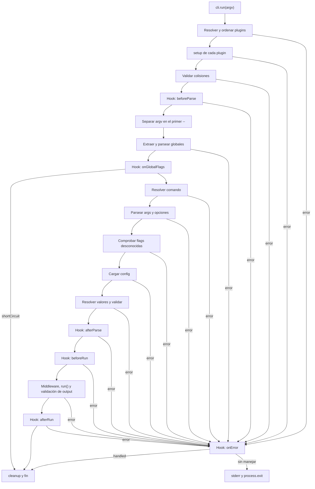
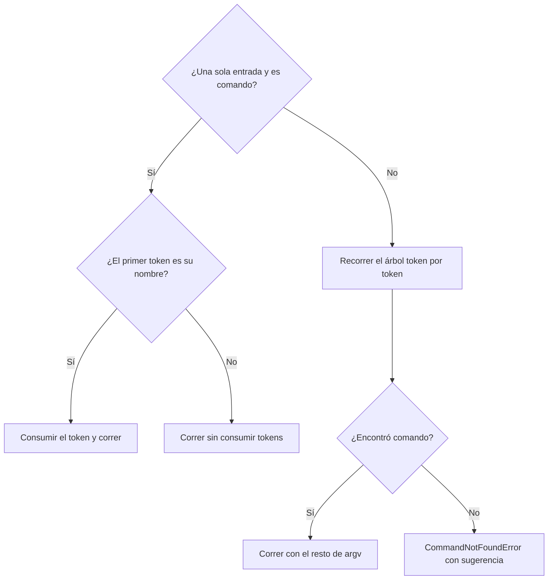
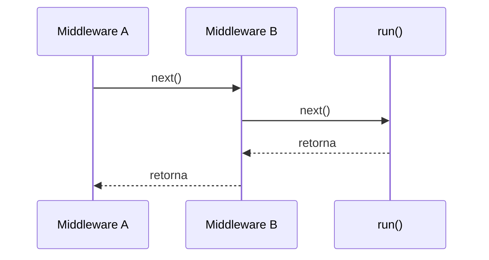

# Ciclo de vida de una ejecución

> **Fuente:** `packages/core/src/cli.ts` (`runCLILifecycle`) · **Verificado:** 2026-10-30

Describe qué pasa desde `cli.run()` hasta que el proceso termina.

> **Problema conocido:** `process.exit` corre dentro del `catch`, así que en esa rama el `finally` no llega a ejecutarse y `cleanup` no corre (KI-001 en [known issues](../known-issues.md)). El diagrama muestra el comportamiento actual.

## Hooks

| Hook | Cuándo | Contexto disponible | Uso típico |
|---|---|---|---|
| `beforeParse` | Antes de parsear | `cli`, `rawArgs` | Modificar argv |
| `onGlobalFlags` | Con globales ya parseadas, antes de resolver el comando | `globalOptions`, `shortCircuit()` | `--help`, `--mcp` |
| `afterParse` | Con todo parseado | `command`, `args`, `options` | Validaciones cruzadas |
| `beforeRun` | Antes del middleware | Igual | Último punto para abortar |
| `afterRun` | Tras una ejecución exitosa | Igual | Telemetría |
| `onError` | Ante un error del ciclo | `error`, `handled` | Formatear o reportar |
| `cleanup` | Al salir del `try` | Lo acumulado | Liberar recursos |

## Reglas

- Los handlers corren en orden de registro.
- Si un handler de `onGlobalFlags` llama a `shortCircuit()`, no corren los siguientes y el ciclo pasa a `cleanup`.
- Si `onError` falla, se registra en stderr y decide el error original.
- Cada handler de `cleanup` corre aunque otro falle.
- `cleanup()` de los plugins corre en orden topológico inverso.
- Marcar `ctx.handled = true` evita la salida por defecto, y `cli.run()` termina sin error.
- `hookCtx.rawArgs` se reduce durante el parseo, mientras `run()` recibe el argv original en `ctx.rawArgs`.

## Resolver el comando

`resolveCommandFromTree` decide así:

Esa primera rama es el modo implícito, que causa KI-006 y KI-015, y que [ADR-0023](../adr/0023-runcli-y-modo-raiz.md) reemplaza.

## Middleware

El primero de la lista es el más externo. La validación de `output` ocurre dentro de la cadena, justo después de `run()`.
