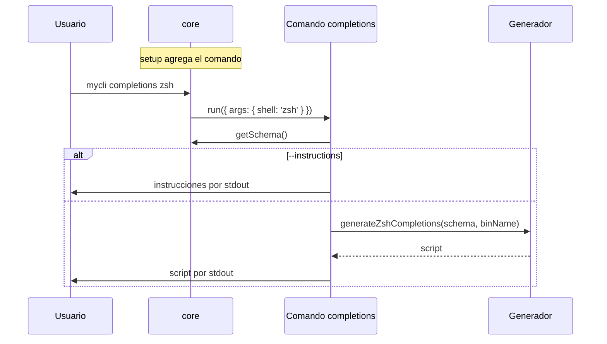

# Generación de completions

> **Fuente:** `packages/completions/src` · **Verificado:** 2026-10-30



## Instalación típica

```bash
mycli completions zsh --instructions
```

Las instrucciones son distintas para cada shell. Runa nunca modifica los archivos del usuario.

## Efecto en el árbol de comandos

`setup` llama a `api.addCommand('completions', ...)`. Con `runCLI`, el modo raíz sigue funcionando: `withRootAtTopLevel` pasa las opciones de la raíz al nivel superior antes de generar. Con `defineCLI`, el árbol pasa a tener dos entradas y se pierde el modo implícito (KI-006 en [known issues](../known-issues.md)).

El comando aparece en sus propias completions, para poder autocompletar `mycli completions <TAB>`.
