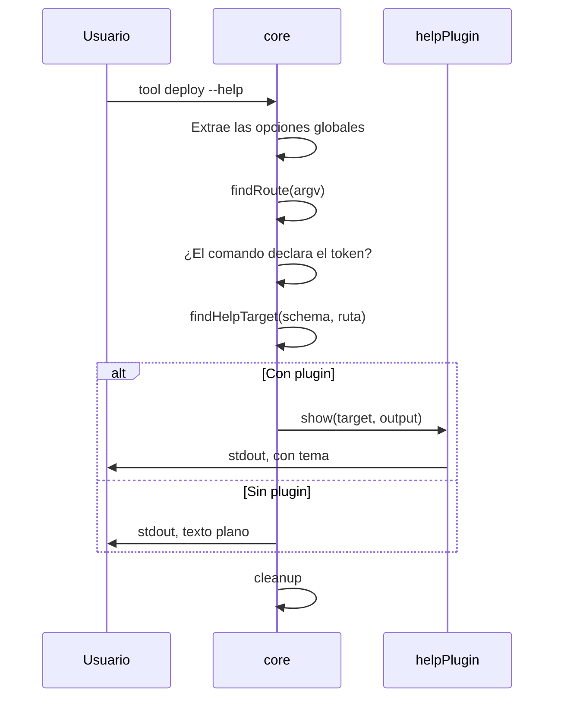

# Ayuda

> **Fuente:** `packages/core/src/help.ts`, `packages/core/src/cli.ts`, `packages/help/src/plugin.ts` · **Verificado:** 2026-10-31

La ayuda vive en `core` ([ADR-0021](../adr/0021-help-y-version-en-core.md)). `helpPlugin` solo cambia cómo se ve.

## Quién se queda con el token

`core` mira `--help` y `-h` por separado, después de extraer las opciones globales. Gana quien lo declaró:

| Quién lo declara | Resultado |
|---|---|
| Una opción global | Es esa opción: nunca llega a la ayuda |
| El comando al que apunta argv | Es la opción del comando. Si declara `-h`, `--help` sigue mostrando la ayuda |
| Nadie | Muestra la ayuda |

Lo que va después de `--` es dato, y nunca muestra la ayuda.

## Cómo se elige qué mostrar

El ruteo es uno solo: `findRoute` usa la misma función que ejecuta un comando, y devuelve hasta dónde llegó. `findHelpTarget` solo busca ese punto en el schema. Si la ruta quedó vacía, muestra la CLI entera.

| Entrada | Muestra | Stream y exit |
|---|---|---|
| `tool --help`, multi-comando | Ayuda raíz | stdout, 0 |
| `tool --help`, un comando | Ayuda del comando | stdout, 0 |
| `tool db --help` | Ayuda de `db`, con sus subcomandos | stdout, 0 |
| `tool db migrate --help` | Ayuda de `db migrate` | stdout, 0 |
| `tool --profile prod status --help` | Ayuda de `status`, porque las globales ya se extrajeron | stdout, 0 |
| `tool nope --help` | Ayuda raíz | stdout, 0 |
| `tool`, multi-comando | Ayuda raíz | stderr, 2 |
| `tool db` | Ayuda de `db` | stderr, 2 |
| `tool nope` | `Command not found`, con sugerencia | stderr, 127 |
| `tool -- --help` | No hay ayuda; es dato | |

Sin nada que correr, es un error de uso ([ADR-0034](../adr/0034-sin-nada-que-correr-es-un-error-de-uso.md)).

`--help` y `--version` no fallan si falta una opción global obligatoria, porque preguntar cómo se usa una CLI no puede exigir ya saberlo. `tool` sin argumentos sí la exige: esa tolerancia solo aplica a una pregunta explícita, para que `--mcp` no pierda sus opciones.

## Qué renderiza

- **Raíz:** nombre, versión, descripción, uso, comandos y opciones globales.
- **Comando:** ruta, descripción, uso, argumentos, opciones por grupo y subcomandos.

`core` agrega a cada comando las opciones globales que no tomó antes de renderizar, así que también las reciben los renderers propios. `--help` y `--version` son parte del schema, y por eso aparecen en la ayuda y en las completions sin código aparte.

## Dos renderers

`renderHelp` en `core` da texto plano, y `defaultRenderer` en `@runa-cmd/help` agrega tema y layout. `packages/help/src/__tests__/alignment.test.ts` exige las mismas secciones, en el mismo orden, y que el plugin muestre todo lo que muestra `core`.

Un plugin reemplaza la ayuda con `api.replaceHelp(show)`, que requiere la capacidad `replaceHelp`. `show` recibe el objetivo y el stream donde escribir. Solo un plugin puede hacerlo: un segundo falla al arrancar con `HELP_ALREADY_REPLACED`.

Ver [known issues](../known-issues.md).
