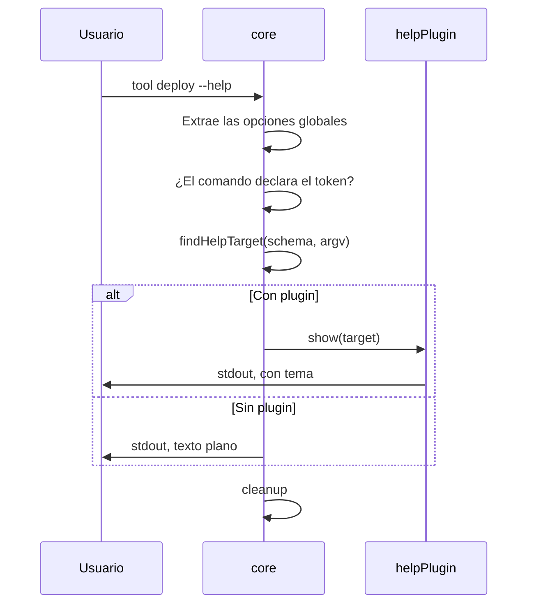

# Ayuda

> **Fuente:** `packages/core/src/help.ts`, `packages/core/src/cli.ts`, `packages/help/src/plugin.ts` · **Verificado:** 2026-10-31

La ayuda vive en `core` ([ADR-0021](../adr/0021-help-y-version-en-core.md)). `helpPlugin` solo cambia cómo se ve.

## Quién se queda con el token

`core` mira `--help` y `-h` por separado, después de extraer las opciones globales. Gana quien lo declaró:

| Quién lo declara | Resultado |
|---|---|
| Una opción global | Es esa opción: nunca llega a la ayuda |
| El comando al que apunta argv | Es la opción del comando. Si declara `-h`, `--help` sigue mostrando la ayuda |
| Nadie | Muestra la ayuda |

Lo que va después de `--` es dato, y nunca muestra la ayuda.

## Cómo se elige qué mostrar

`findHelpTarget` recorre argv por el árbol de comandos, salteando flags, y se queda con el más profundo. Si no encuentra ninguno y la CLI tiene comando raíz, como con `runCLI`, usa ese. Si no, muestra la CLI entera.

| Entrada | Muestra | ¿Correcto? |
|---|---|---|
| `tool --help` | Ayuda raíz | Sí en multi-comando y con `runCLI`; no en modo implícito (KI-011) |
| `tool deploy --help` | Ayuda de `deploy` | Sí |
| `tool db --help` | Ayuda de `db`, con sus subcomandos | Sí |
| `tool db migrate --help` | Ayuda de `db migrate` | Sí |
| `tool --profile prod status --help` | Ayuda de `status` | Sí, porque las globales ya se extrajeron |
| `tool nope --help` | Ayuda raíz | Sí |
| `tool -- --help` | No hay ayuda; es dato | Sí |

## Qué renderiza

- **Raíz:** nombre, versión, descripción, uso, comandos y opciones globales.
- **Comando:** ruta, descripción, uso, argumentos, opciones por grupo y subcomandos.

`core` agrega a cada comando las opciones globales que no tomó antes de renderizar, así que también las reciben los renderers propios. `--help` y `--version` son parte del schema, y por eso aparecen en la ayuda y en las completions sin código aparte.

## Dos renderers

`renderHelp` en `core` da texto plano, y `defaultRenderer` en `@runa-cmd/help` agrega tema y layout. `packages/help/src/__tests__/alignment.test.ts` exige las mismas secciones, en el mismo orden, y que el plugin muestre todo lo que muestra `core`.

Un plugin reemplaza la ayuda con `api.replaceHelp(show)`, que requiere la capacidad `replaceHelp`. Solo un plugin puede hacerlo: un segundo falla al arrancar con `HELP_ALREADY_REPLACED`.

Ver [known issues](../known-issues.md).
