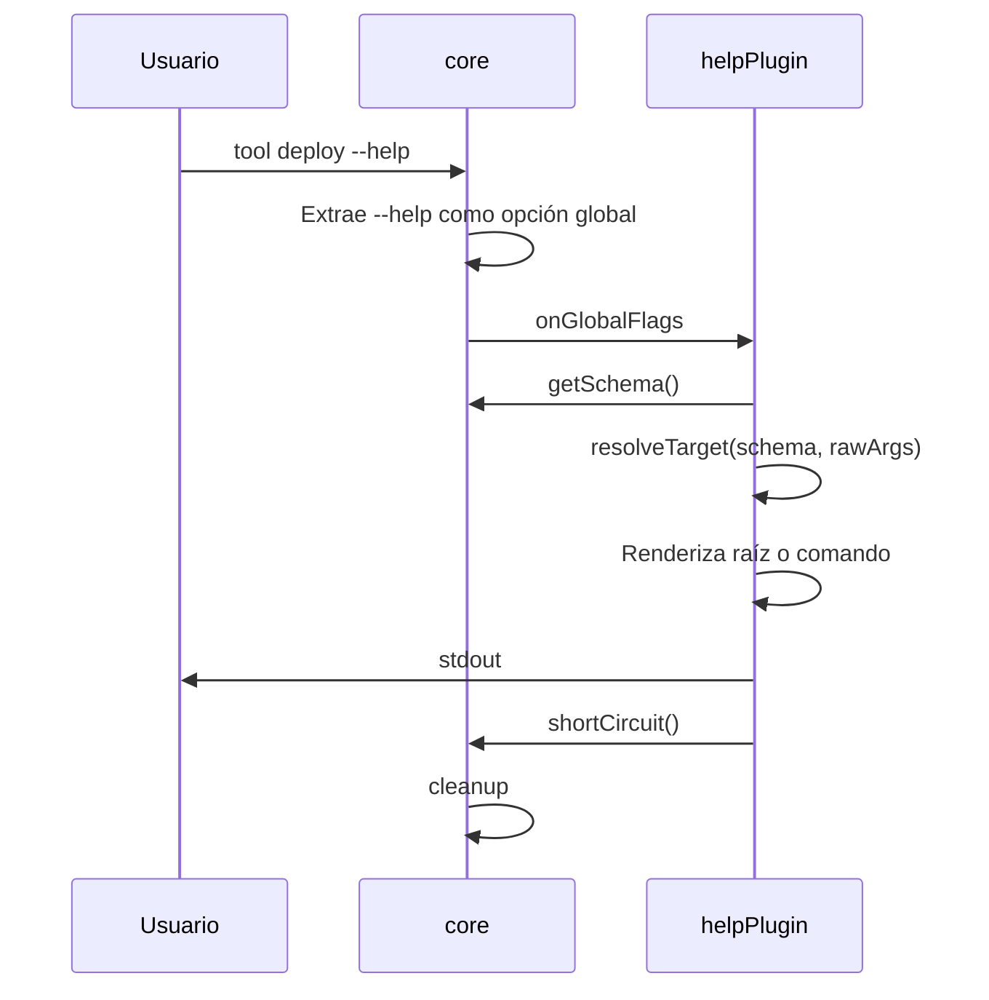

# Ayuda

> **Fuente:** `packages/help/src/plugin.ts`, `packages/help/src/render.ts` · **Verificado:** 2026-10-30

Describe el flujo actual. [ADR-0021](../adr/0021-help-y-version-en-core.md) lo cambiará.

## Cómo se elige qué mostrar

`resolveTarget` toma el primer token que no empieza con `-` y lo busca en el primer nivel de comandos.

| Entrada | Muestra | ¿Correcto? |
|---|---|---|
| `tool --help` | Ayuda raíz | Sí en multi-comando; no en comando único (KI-011) |
| `tool deploy --help` | Ayuda de `deploy` | Sí |
| `tool hola --help`, comando único | Ayuda raíz | No (KI-011) |
| `tool db migrate --help` | Ayuda de `db` | No (KI-012) |
| `tool --profile prod status --help` | Ayuda de `status` | Sí, porque las globales ya se extrajeron |
| `tool -- --help` | No hay ayuda; es dato | Sí |

## Qué renderiza

- **Raíz:** nombre, versión, descripción, uso, comandos y opciones globales.
- **Comando:** ruta, descripción, uso, argumentos, opciones por grupo y subcomandos. No incluye versión ni opciones globales.

Ver [known issues](../known-issues.md).
