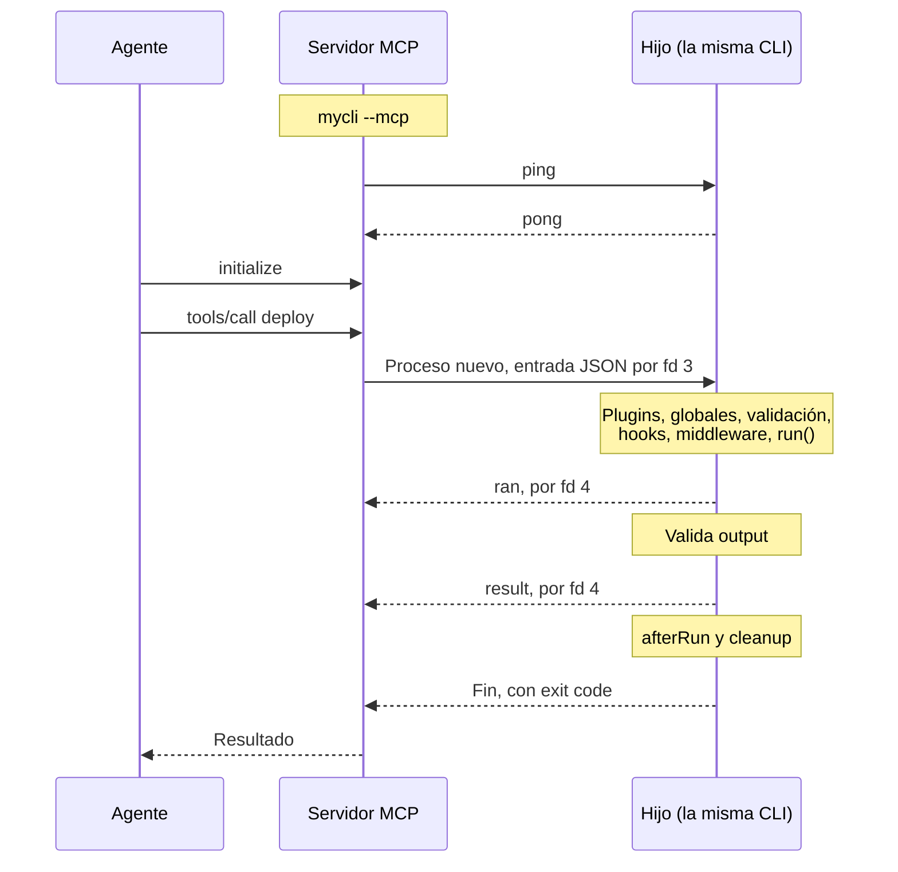

# Llamada a una tool MCP

> **Fuente:** `packages/mcp/src`, `packages/core/src/tool-channel.ts` · **Verificado:** 2026-10-30

Cada tool es el mismo comando que corre una persona, ejecutado en un subproceso de la propia CLI ([ADR-0030](../adr/0030-tools-mcp-en-subproceso.md)).

## Arranque

1. `mcpPlugin` registra `--mcp` como opción global.
2. En `onGlobalFlags`, si la flag está activa, carga el SDK. Una ejecución normal de la CLI no paga ese costo.
3. Se ejecuta a sí mismo con un `ping`. Si no recibe `pong`, falla con `MCP_SELF_CHECK_FAILED` y sugiere `selfCommand`.
4. Atiende por stdio hasta que el cliente se desconecta o recibe SIGINT o SIGTERM. Recién ahí sigue el ciclo de vida, y corren los `cleanup` del servidor.

## Cada llamada

- **Entrada:** se descartan las opciones que fijó quien opera ([ADR-0031](../adr/0031-quien-opera-gana-al-modelo.md)), y el resto viaja sin validar, como JSON por fd 3. La valida el hijo, así que un `.transform` corre una sola vez, y los errores son los de la CLI.
- **Comando:** se elige por su ruta, no por tokens. Un dato nunca puede ejecutar otro comando.
- **Globales:** el hijo recibe el argv con que arrancó el servidor, sin `--mcp`.
- **Entorno:** el hijo hereda el del servidor. La variable del canal se borra al leerla, así que una CLI que lance el comando es una CLI normal.
- **Procesos:** stdin queda cerrado, y stdout y stderr son del comando.

## Cómo se arma el resultado

El hijo informa hasta dónde llegó: `running` antes de `run()`, `ran` cuando vuelve, y `result` cuando todo el comando terminó y su `output` es válido. Si termina en error, `failed` indica si fue la entrada, el `output` u otra cosa. Stdout y stderr pasan por la redacción de valores fijos; el valor devuelto, no.

| Hijo | Clase | Efecto |
|---|---|---|
| `result`, exit 0, sin `failed` | Éxito: el valor como texto, o stdout, más `structuredContent` si `output` es un objeto | |
| `result` con `failed` o exit distinto de 0 | `after_run_failed` | `completed` |
| `ran` y `failed` por `output` | `invalid_output` | `completed` |
| `ran`, otro caso | `after_run_failed` | `completed` |
| `running` y `failed` | `command_failed` | `unknown` |
| `running`, sin `failed` | `crashed` | `unknown` |
| Sin `running`, `failed` por entrada | `invalid_input` | `none` |
| Sin `running`, otro `failed` | `rejected` | `none` |
| Sin informes, exit 0 | `not_run` | `none` |
| Sin informes, exit distinto de 0 | `crashed` | `none` |

Exit 0 no alcanza para considerar exitosa una llamada: un middleware puede saltear el comando, y un comando puede llamar a `process.exit(0)`.

El texto lleva el motivo que escribió el comando y una frase sobre el efecto, porque `_meta` es para el cliente y puede no llegar al modelo. Las pistas para personas, como `RUNA_DEBUG` o `--help`, no aparecen salvo que quien opera active `RUNA_DEBUG`.

## CLI y tool

| Etapa | CLI | Tool |
|---|---|---|
| Elegir comando | Desde argv | Por ruta |
| Valores | Tokens de `parseArgs` | Objeto JSON |
| Env, config, globales | Sí | Sí |
| Hooks y middleware | Sí | Sí |
| `ctx.invocation` | `{ surface: 'cli' }` | `{ surface: 'tool', tool }` |
| Latencia | Directa | Medida: 138 ms de mediana por llamada, en una CLI mínima |

## Límites actuales

Se resuelven en [T-305](../backlog.md#t-305-cancelación-y-límites): cancelar no corre `cleanup` del hijo y no hay tope de salida.
