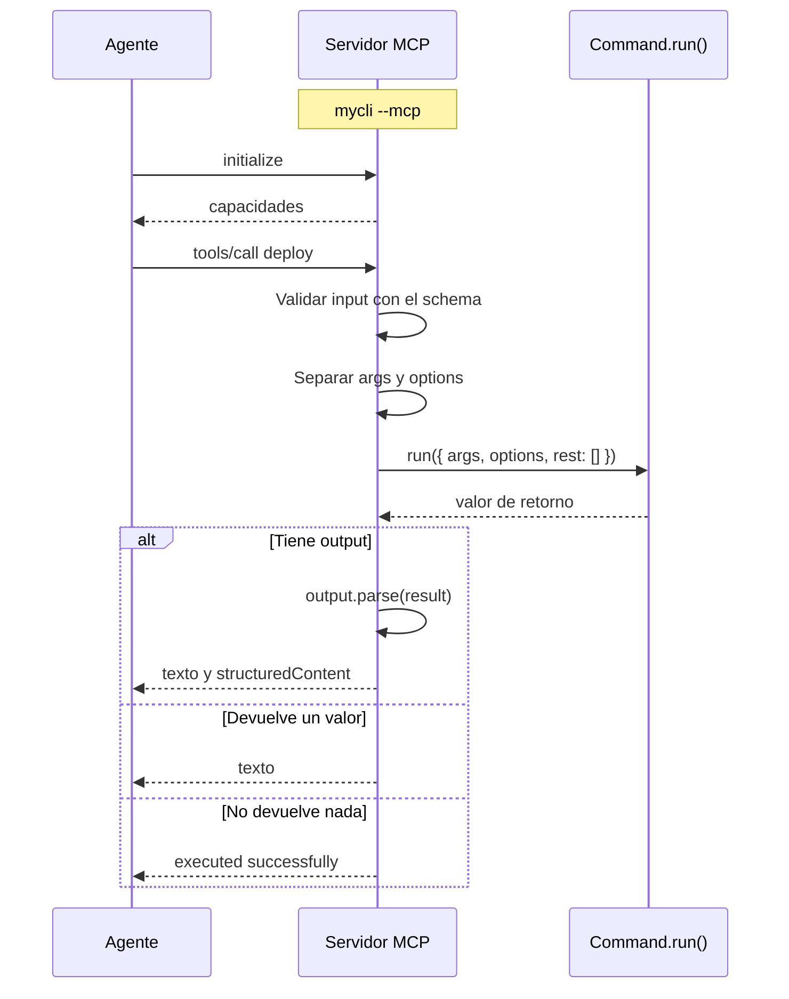

# Llamada a una tool MCP

> **Fuente:** `packages/mcp/src` · **Verificado:** 2026-10-30

Describe el flujo actual, incluidos sus límites conocidos.

## Arranque

1. `mcpPlugin` registra `--mcp` como opción global.
2. En `onGlobalFlags`, si la flag está activa, construye las tools desde `getCommands()` y `getSchema()`.
3. Conecta el transporte stdio y llama a `shortCircuit()`.
4. El ciclo pasa a `cleanup`, pero el proceso sigue vivo por el servidor.
5. SIGINT o SIGTERM cierran el servidor y terminan el proceso.

## Comparación con una ejecución CLI

| Etapa | CLI | MCP hoy |
|---|---|---|
| Validación de input | `resolveValues` | Schema de la tool |
| Env | Sí | No |
| Config | Sí | No |
| `afterParse`, `beforeRun`, `afterRun` | Sí | No |
| Middleware | Sí | No |
| `globalOptions` | Sí | Vacío |
| Stdout de `run()` | Va al usuario | Ensucia el protocolo y no llega al agente |
| Validación de `output` | Sí | Sí |

Las filas de env, config, hooks y middleware salen de leer `packages/mcp/src/server.ts`. La de stdout se observó ejecutando una llamada real (KI-003 y KI-008 en [known issues](../known-issues.md)). [ADR-0030](../adr/0030-tools-mcp-en-subproceso.md) define cómo debería ser: cada tool en un subproceso de la propia CLI.
