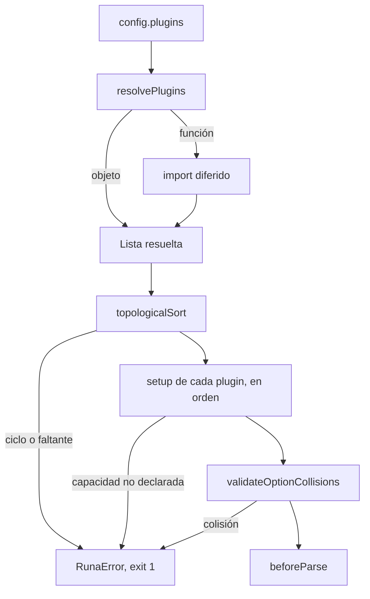

# Carga de plugins

> **Fuente:** `packages/core/src/plugin.ts` · **Verificado:** 2026-10-30

Corre en cada `cli.run()`, antes de parsear.

## Capacidades

| Método | Capacidad requerida |
|---|---|
| `addCommand` | `addCommands` |
| `addGlobalOption` | `addGlobalOptions` |
| `addMiddleware` | `addMiddleware` |
| `hook`, `getSchema`, `getCommands` | Ninguna |

## Colisiones

`validateOptionCollisions` revisa, en este orden:

1. Una opción global registrada dos veces.
2. Dos globales que usan el mismo nombre o alias.
3. Una global contra una opción de cualquier comando del árbol.

El primer conflicto lanza `OPTION_COLLISION` y frena toda la CLI, aunque el comando afectado no se esté usando (KI-014 en [known issues](../known-issues.md)).

## Detalles

- `setup` recibe un `PluginAPI` limitado a las capacidades declaradas.
- `addCommand` sobrescribe sin aviso un comando con el mismo nombre.
- `getSchema()` refleja los comandos y globales agregados hasta ese momento.
- Si un plugin falla al cargarse, el error pasa por `onError` como cualquier otro.
