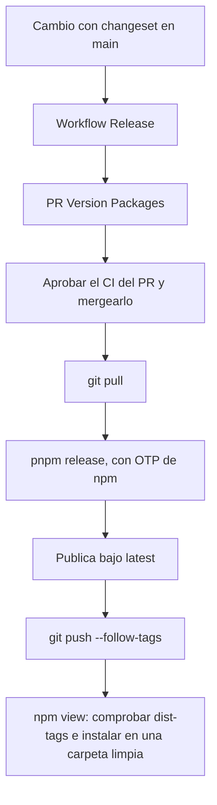

# Release

> **Fuente:** `.github/workflows/release.yml`, `.changeset/`, `scripts/peers.mjs` · **Verificado:** 2026-11-15, con la publicación de `core` 1.1.0

## Reglas

- Cada paquete tiene su versión desde la 1.0.0, y el grupo `fixed` está vacío ([ADR-0039](../adr/0039-paquetes-independientes-desde-1-0.md)). Sale solo el paquete que tiene un changeset: la 1.1.0 de `core` salió sola, y `help`, `completions`, `create` y `mcp` siguieron en su versión.
- `mcp` sigue en `0.x` hasta completar su propia ventana ([ADR-0050](../adr/0050-la-1-0-sale-sin-mcp.md)).
- Todo se publica bajo `latest`. `beta` quedó en `0.2.0-beta.7` y no se mueve más.
- El peer de `core` en `help`, `completions` y `mcp` es `^1.0.0`. Una versión nueva de `core` dentro de la 1.x no obliga a publicar los plugins. Un plugin que empieza a usar algo nuevo de `core` sube su peer a mano a la versión que lo trae, con su propio changeset. Hoy nada lo comprueba: con `fixed` vacío, `scripts/peers.mjs` no revisa ningún peer, y cómo hacerlo queda en [T-506](../backlog.md#t-506-salir-de-pre-release-y-publicar-100).
- Los peer ranges de `core` son explícitos, no `workspace:*`. Así `onlyUpdatePeerDependentsWhenOutOfRange` no escala un release a mayor mientras el peer siga en rango.
- El PR "Version Packages" lo abre `changesets/action` con el `GITHUB_TOKEN`, así que GitHub no corre su CI solo: queda en `action_required` hasta que alguien lo aprueba.
- CI no publica: no hay `NPM_TOKEN`.

Pasos detallados en `CONTRIBUTING.md`. Decisión en [ADR-0016](../adr/0016-release-con-changesets.md), con el grupo `fixed` terminado por ADR-0039.

## Pendiente

[T-506](../backlog.md#t-506-salir-de-pre-release-y-publicar-100) deja pasar a Changesets 3.x con `changesets/action@v2`, y decidir cómo se comprueba el peer de cada plugin. [T-505](../backlog.md#t-505-trusted-publishing), opcional, define la publicación desde CI.
