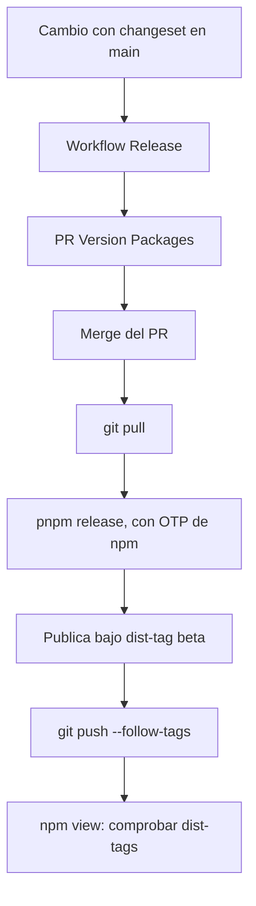

# Release

> **Fuente:** `.github/workflows/release.yml`, `.changeset/` · **Verificado:** 2026-10-30

## Reglas

- Los cuatro paquetes se versionan juntos, como grupo `fixed`.
- Mientras dure el modo pre-release, las versiones son `0.2.0-beta.N`, y `latest` no cambia.
- CI no publica: no hay `NPM_TOKEN`.
- Los peer ranges de `core` son explícitos. Si empieza una serie minor nueva y no se amplían, Changesets escala el release a mayor.

Pasos detallados en `CONTRIBUTING.md`. Decisión en [ADR-0016](../adr/0016-release-con-changesets.md).

## Camino a 1.0.0

[T-506](../backlog.md#t-506-salir-de-pre-release-y-publicar-100) define la salida de pre-release, y [T-505](../backlog.md#t-505-trusted-publishing) la publicación desde CI.
