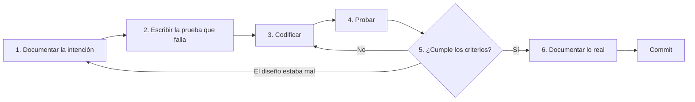

# Forma de trabajar

Runa sigue **documentar, probar, codificar, probar, verificar y documentar**. Combina dos prácticas conocidas: Documentation-Driven Development, que define el comportamiento por escrito antes de construirlo, y Test-Driven Development, que escribe primero una prueba que falla.



## Los seis pasos

| Paso | Qué se hace | Terminado cuando |
|---|---|---|
| 1. Documentar | Elegir la tarea del [backlog](./backlog.md) y pasarla a `En curso`. Revisar sus criterios. Si la decisión es difícil de revertir, leer el [índice de ADRs](./adr/README.md) y agregar uno si hace falta | Los criterios se pueden comprobar sin interpretar |
| 2. Probar | Escribir tests desde los criterios, no desde la implementación | Fallan por el motivo esperado |
| 3. Codificar | Hacer el cambio mínimo para cumplir los criterios | Compila |
| 4. Probar | Correr `pnpm build && pnpm test && pnpm typecheck && pnpm lint` | Todo pasa |
| 5. Verificar | Comprobar cada criterio. Si hay interfaz, ejecutar la CLI real | Cada criterio tiene evidencia |
| 6. Documentar | Actualizar lo que cambió, según la tabla de abajo, y cerrar la tarea | `pnpm docs:check` pasa |

## Tests de aceptación

`packages/core/src/__tests__/acceptance/` ejecuta una CLI real como proceso hijo, sin mocks, contra el `dist` compilado. Si `dist` falta o está desactualizado, la suite se detiene y pide `pnpm build`.

Cada comportamiento que una tarea todavía no entregó se marca con `pending`, de `harness.ts`, y su ID:

- **Mientras falta:** el caso cuenta como fallo esperado.
- **Al resolverlo:** el caso se pone rojo. La tarea tiene que cambiar `pending` por `it`.
- **Para ver el fallo real:** `RUNA_SHOW_PENDING=1 pnpm --filter @runa-cmd/core exec vitest run src/__tests__/acceptance`.

Si un comportamiento depende de `process.exit`, stdout o exit codes, probalo acá. Un mock de `process.exit` ya ocultó que `cleanup` no corría ante errores.

## Qué actualizar al terminar

| Si cambió… | Actualizá |
|---|---|
| API pública o comportamiento | [Componente](./components/) y README del paquete |
| Un recorrido o su orden | [Flujo](./flows/) |
| Una decisión | ADR nuevo; los aceptados no se editan |
| Un problema se resolvió o apareció | [Known issues](./known-issues.md) |
| Versiones, salud técnica o decisiones abiertas | [Estado](./status.md) |
| Estado de una tarea | [Backlog](./backlog.md) |
| Paquete publicado | Changeset, con guía de migración si rompe algo |

## Qué se controla y qué no

**Lo que se controla:** `pnpm docs:check` corre en el hook local y en CI.

| Control | Falla si |
|---|---|
| Enlaces | Un enlace relativo o su ancla no existen |
| Rutas | Un documento nombra un archivo de `packages/` que no existe |
| ADRs | Un ADR no figura en el índice, o le faltan campos |
| Backlog | Hay IDs repetidos, o un estado o valor de v1 inválido |
| Known issues | Hay IDs repetidos, una fila sin tarea, o un documento cita un issue que ya no existe |
| Commits | Un commit cambia `packages/*/src` sin tocar también `docs/` y tests |

**Lo que no se controla:** ninguna herramienta puede demostrar que el documento y la prueba se escribieron antes del código. El control comprueba que los tres lleguen juntos. El orden depende de la disciplina y de la revisión. Un test que nace fallando deja constancia cuando se hace visible, por eso [T-001](./backlog.md#t-001-tests-de-aceptación-con-procesos-reales) marca los casos pendientes como fallo esperado.

### Instalar el hook

Una sola vez por clon:

```bash
git config core.hooksPath .githooks
```

CI repite el control por si el hook no está activo.

### Excepciones

Si un commit toca código sin cambiar comportamiento, como un comentario o un refactor puro, declaralo en el mensaje:

```text
refactor(core): extract option parsing

Process-Skip: sin cambio de comportamiento; la cobertura existente alcanza
```

El motivo es obligatorio y queda en el historial. Si aparecen muchas excepciones, hay que revisar el control, como indica [ADR-0026](./adr/0026-docs-como-fuente-de-verdad.md).

## Para modelos LLM

- Seguí el ciclo completo aunque el cambio parezca chico.
- Si no podés correr una prueba, decilo. No marques una tarea como `Hecho` sin evidencia.
- Si los criterios no alcanzan o se contradicen, frená y preguntá.
- No uses `Process-Skip` para esquivar una falla del control.
- Trabajamos sobre `main`. Commit y push solo cuando la persona lo pida.
